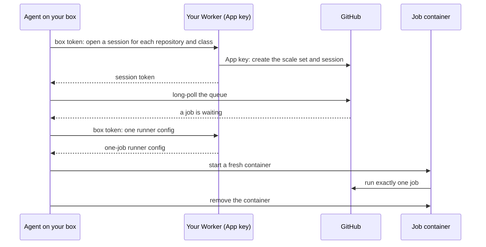

<p align="center">
  <a href="https://boxrunner.zabcik.me"></a>
</p>

<p align="center">
  <a href="https://github.com/dominikzabcik/boxrunner/releases/latest"></a>
  <a href="https://github.com/dominikzabcik/boxrunner/actions/workflows/ci.yml"></a>
  
  <a href="worker"></a>
  <a href="LICENSE"></a>
</p>

<p align="center">
  <a href="https://boxrunner.zabcik.me"><b>Website</b></a> ·
  <a href="#quickstart"><b>Quickstart</b></a> ·
  <a href="docs/architecture.md"><b>Architecture</b></a> ·
  <a href="docs/config.md"><b>Configuration</b></a> ·
  <a href="docs/decisions.md"><b>Decisions</b></a> ·
  <a href="SECURITY.md"><b>Security</b></a>
</p>

**GitHub Actions runners on the Linux box you already pay for.** Every job gets a fresh container that is gone when the job ends. Your GitHub App key stays in a Cloudflare Worker and never touches the box. Your main CI job keeps the box's full speed while lighter jobs use only the cores it leaves idle.



## Quickstart

You need a Linux box with systemd (Ubuntu 22.04 or newer, Debian 11 or newer; amd64 or arm64) and a free Cloudflare account.

1. **Deploy the Worker.** With one click, where Cloudflare asks for a setup secret (keep it, the setup page asks for it):

   [](https://deploy.workers.cloudflare.com/?url=https://github.com/dominikzabcik/boxrunner/tree/main/worker)

   Or from a clone of this repository:
   ```sh
   cd worker && bun install
   bunx wrangler deploy
   secret=$(openssl rand -base64 36) && echo "$secret"
   echo "$secret" | bunx wrangler secret put SETUP_SECRET
   ```
   Keep the printed secret: the setup page asks for it.
2. **Create the GitHub App.** Open `https://<your worker>/setup`, enter the setup secret and confirm on GitHub. Install the App on the private repositories whose jobs should run on your box.
3. **Install the agent.** The setup page shows the command, which looks like this:
   ```sh
   curl -fsSL https://boxrunner.zabcik.me/install.sh \
     | sudo sh -s -- --worker https://<your worker> --token <box token>
   ```
4. **Use it.** In a workflow, `runs-on: boxrunner`, or `runs-on: boxrunner-light` for jobs that should only use idle cores.


<sub>Install and `doctor` on a fresh Ubuntu 24.04 VM, with the Worker and token passed as `BOXRUNNER_WORKER` and `BOXRUNNER_TOKEN`. Doctor's last line, the Worker check, is cut because it names our own Worker. Pauses longer than 1.5 s are shortened; building the job image took about seven minutes.</sub>

For `services:`, `container:` jobs and `docker build`, add `--docker` to the install command, which installs [Sysbox](https://github.com/nestybox/sysbox) and gives each job its own Docker daemon; the [configuration](docs/config.md#docker-inside-jobs) explains the limits.

`sudo boxrunner doctor` checks the box, including that a job cannot reach the host, your private network or the cloud metadata service. `sudo boxrunner status` shows what runs, and `sudo boxrunner shell` opens a shell in a running job, or in a failed one a class keeps for you. When a new box takes over from one that died, [replacing a box](docs/architecture.md#replacing-a-box) says how to recover the jobs the old one had acquired.

## Why

<table>
  <tr>
    <td width="33%" valign="top">
      <br>
      <b>One job, one container</b><br>
      Each job starts in a clean container from the same image, which is removed when the job ends. Nothing one job leaves behind reaches the next.
    </td>
    <td width="33%" valign="top">
      <br>
      <b>The key stays off the box</b><br>
      The App key lives only in your Worker. The box holds a token that can ask for runners and nothing else, and each queue gets a session token that reads that queue and nothing else.
    </td>
    <td width="33%" valign="top">
      <br>
      <b>Priority classes</b><br>
      A <code>normal</code> class gets the box's full speed. An <code>idle</code> class runs only on cores nothing else wants (Linux's SCHED_IDLE), so CodeQL, deploys and link checks never slow your test suite.
    </td>
  </tr>
  <tr>
    <td width="33%" valign="top">
      <br>
      <b>Starts in seconds, no open port</b><br>
      The agent long-polls GitHub's queue for runner scale sets, the protocol GitHub's Kubernetes controller uses. A job starts 6 to 12 seconds after it is queued, or 2 seconds with a warm runner.
    </td>
    <td width="33%" valign="top">
      <br>
      <b>Nothing extra to run</b><br>
      No Kubernetes, no database and no cloud account beyond the Worker, which fits Cloudflare's free plan. On the box, one binary, a systemd unit and Docker.
    </td>
    <td width="33%" valign="top">
      <br>
      <b>Hardened by default</b><br>
      Jobs run on their own bridge, cut off from the host, private ranges, tailnets and the metadata service, under CPU, memory and process limits. The Worker refuses public repositories.
    </td>
  </tr>
</table>

## Why it exists

A personal website ran Lighthouse, Playwright and CodeQL on every pull request and used all 2,000 of GitHub Free's private minutes in twelve days. A 4-core VPS that was already paid for now runs every job:

| | GitHub's runners | boxrunner |
|---|---|---|
| Test suite with Lighthouse | about 15 min | 11.6 to 12.6 min |
| Queue to start | | 6 to 12 s |
| Cost | $0.006 a minute after the free 2,000 | the box you have |

## How it works



<details>
<summary>The same flow as a sequence diagram</summary>



</details>

The [architecture](docs/architecture.md) explains each part and what it holds, and the [decisions](docs/decisions.md) record the measurements behind them. The [configuration](docs/config.md) covers classes, limits and custom job images.

## Compared with

| | boxrunner | [Zoomies](https://github.com/eyupio/zoomies) | [runscaler](https://github.com/ysya/runscaler) | [GARM](https://github.com/cloudbase/garm) | [ARC](https://github.com/actions/actions-runner-controller) |
|---|---|---|---|---|---|
| Runs on | one Linux box you own | your hosts: a controller and agents | a Docker host or Apple Silicon Mac | many clouds, LXD, Incus, Kubernetes | Kubernetes |
| Where the GitHub credential lives | App key in a Cloudflare Worker; the box holds only a scoped token | App key in the controller | personal access token on the host | App key or token in the GARM server | App key or token in the cluster |
| One environment per job | container | container | container or macOS VM | per provider | pod |
| Priority between jobs | strict idle class (SCHED_IDLE) | guaranteed shares, idle CPU lent out | none | none | none |
| Docker inside jobs | own daemon under Sysbox, no privileges, opt-in | Docker-in-Docker, opt-in | Docker-in-Docker or the host's socket, opt-in | per provider | privileged sidecar |
| License | Apache-2.0 | AGPL-3.0 | MIT | Apache-2.0 | Apache-2.0 |

Checked against each project's README on October 14, 2026. Corrections are welcome.

## When not to use it

- **Public repositories.** Anyone who can open a pull request could run code on your box. The Worker refuses them.
- **macOS or Windows jobs.** boxrunner runs Linux containers.
- **Many machines or autoscaling across hosts.** One Worker serves one box today. [GARM](https://github.com/cloudbase/garm) and [Actions Runner Controller](https://github.com/actions/actions-runner-controller) manage fleets.
- **Untrusted code.** Jobs share the host's kernel, like all containers.

## Uninstall

```sh
sudo boxrunner uninstall
```

It closes the box's sessions and removes the service, containers, network, firewall rules and files. Docker stays, and so does Sysbox if `install --docker` added it.

## Contributing

Issues, fixes and docs are welcome; see [CONTRIBUTING.md](CONTRIBUTING.md), and the [good first issues](https://github.com/dominikzabcik/boxrunner/labels/good%20first%20issue) are a place to start. Questions and ideas go to [Discussions](https://github.com/dominikzabcik/boxrunner/discussions). Report security problems privately as described in [SECURITY.md](SECURITY.md).

<br>

<p align="center">
  <a href="https://boxrunner.zabcik.me"></a>
  <br>
  <sub>Licensed under the <a href="LICENSE">Apache License 2.0</a> · <a href="https://boxrunner.zabcik.me">boxrunner.zabcik.me</a></sub>
</p>
