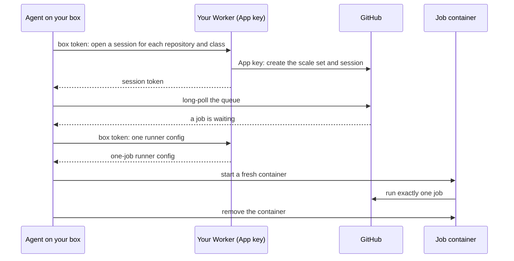

# boxrunner

**GitHub Actions runners on the Linux box you already pay for.** Every job gets a fresh container that is gone when the job ends. Your GitHub App key stays in a Cloudflare Worker and never touches the box. Your main CI job keeps the box's full speed while lighter jobs use only the cores it leaves idle.

```text
4 threads of CPU work in a normal-priority job, on a 4-core ARM VPS:

alone                                428 ms
beside 4 busy jobs at idle priority  429 ms   +0%
beside 4 busy jobs at normal         2.1 s    +390%
```

<sub>Measured with `boxrunner bench`, which you can run on your own box.</sub>

## Quickstart

You need a Linux box with systemd (Ubuntu 22.04 or newer, Debian 11 or newer; amd64 or arm64) and a free Cloudflare account.

1. **Deploy the Worker.** From a clone of this repository:
   ```sh
   cd worker && bun install
   bunx wrangler deploy
   secret=$(openssl rand -base64 36) && echo "$secret"
   echo "$secret" | bunx wrangler secret put SETUP_SECRET
   ```
   Keep the printed secret: the setup page asks for it.
2. **Create the GitHub App.** Open `https://<your worker>/setup`, enter the setup secret and confirm on GitHub. Install the App on the private repositories whose jobs should run on your box.
3. **Install the agent.** The setup page shows the command, which looks like this:
   ```sh
   curl -fsSL https://github.com/dominikzabcik/boxrunner/releases/latest/download/install.sh \
     | sudo sh -s -- --worker https://<your worker> --token <box token>
   ```
4. **Use it.** In a workflow, `runs-on: boxrunner`, or `runs-on: boxrunner-light` for jobs that should only use idle cores.

For `services:`, `container:` jobs and `docker build`, add `--docker` to the install command, which installs [Sysbox](https://github.com/nestybox/sysbox) and gives each job its own Docker daemon; the [configuration](docs/config.md#docker-inside-jobs) explains the limits.

`sudo boxrunner doctor` checks the box, including that a job cannot reach the host, your private network or the cloud metadata service. `sudo boxrunner status` shows what runs.

## Why

- **One job, one container.** Each job starts in a clean container from the same image, and the container is removed when the job ends. Nothing one job leaves behind reaches the next.
- **The key stays off the box.** The GitHub App can administer your repositories, so its key lives only in your Worker. The box holds a token that can ask the Worker for runners and nothing else, and a session token per queue that can read that queue and nothing else.
- **Priority classes.** A `normal` class gets the box's full speed. An `idle` class runs only on cores nothing else wants (Linux's SCHED_IDLE), so CodeQL, deploys and link checks never slow your test suite.
- **Starts in seconds, without an open port.** The agent long-polls GitHub's queue for runner scale sets, the same protocol GitHub's Kubernetes controller uses. A job starts 6 to 8 seconds after it is queued.
- **Nothing extra to run.** No Kubernetes, no database, no cloud account beyond the Worker, which fits Cloudflare's free plan.
- **Hardened by default.** Jobs run on their own bridge with traffic to the host, private ranges, tailnets and the metadata service dropped, under CPU, memory and process limits, and no runner starts when the disk runs low. The Worker refuses public repositories.

## Why it exists

A personal website ran Lighthouse, Playwright and CodeQL on every pull request and used all 2,000 of GitHub Free's private minutes in twelve days. A 4-core ARM VPS that was already paid for now runs every job:

| | GitHub's runners | boxrunner |
|---|---|---|
| Test suite with Lighthouse | about 15 min | 11.6 min |
| Queue to start | | 6 to 8 s |
| Cost | $0.006 a minute after the free 2,000 | the box you have |

## How it works



The [architecture](docs/architecture.md) explains each part and what it holds, and the [decisions](docs/decisions.md) record the measurements behind them. The [configuration](docs/config.md) covers classes, limits and custom job images.

## When not to use it

- **Public repositories.** Anyone who can open a pull request could run code on your box. The Worker refuses them.
- **macOS or Windows jobs.** boxrunner runs Linux containers.
- **Many machines or autoscaling across hosts.** One Worker serves one box today. [GARM](https://github.com/cloudbase/garm) and [Actions Runner Controller](https://github.com/actions/actions-runner-controller) manage fleets.
- **Untrusted code.** Jobs share the host's kernel, like all containers.

## Uninstall

```sh
sudo boxrunner uninstall
```

It closes the box's sessions and removes the service, containers, network, firewall rules and files. Docker stays, and so does Sysbox if `install --docker` added it.

## Contributing

Issues, fixes and docs are welcome; see [CONTRIBUTING.md](CONTRIBUTING.md). Report security problems privately as described in [SECURITY.md](SECURITY.md).

Licensed under the [Apache License 2.0](LICENSE).
