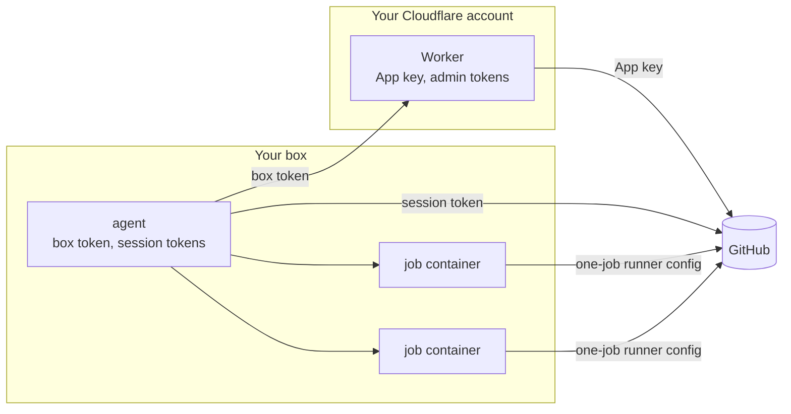

# Architecture

boxrunner runs GitHub Actions jobs in fresh containers on a Linux box you already own. This page is the contract the code follows: when the code and this page disagree, one of them is a bug. Numbers marked *measured* come from the probes in [decisions](decisions.md).

## Goals

- **One fresh container per job.** Nothing a job installs or leaves behind reaches the next job.
- **The GitHub App key never touches the box.** The box holds tokens that can do much less than the App.
- **Your main job keeps its speed.** A lighter class can use only the cores the main job leaves idle.
- **Costs nothing beyond the box today.** The Worker fits Cloudflare's free plan, and GitHub charges nothing for self-hosted minutes. GitHub announced such a fee for 2026 and then postponed it.
- **Runs unattended.** Every step converges, so a restart, a crash or a second `install` leaves the box in the same state.

## Not in scope

- **Public repositories.** Anyone who can open a pull request can run code on a self-hosted runner, so the Worker refuses public repositories. There is no switch.
- **Virtual-machine isolation.** Jobs share the host kernel. Firecracker and Kata need `/dev/kvm`, which common VPS plans do not offer.
- **One label spread over several boxes.** Several boxes can share a Worker when each serves its own classes or repositories ([config](config.md#several-boxes)). Two boxes that serve the same repository and class do not share its jobs, because one session at a time holds a scale set.
- **A hosted service.** Everyone runs their own Worker and their own box.

## Parts and what each one holds



| Part | Holds | Can do |
|---|---|---|
| Worker | The App's private key and webhook secret. Admin tokens, each for one repository and ten minutes (*measured*). | What the App may do on the repositories it is installed on |
| Agent | A box token. One session token per scale set, valid 70 minutes (*measured*). | Through the Worker: find scale sets, open and close sessions, mint one-job runner configs, remove runners, all only for private repositories the App is installed on and only for the Worker's classes. Directly at GitHub: read its own queue, acknowledge messages, acquire jobs. |
| Job container | One runner config, then the job's own `GITHUB_TOKEN` and secrets | Run one job |

A session token is refused ("Invalid Claims") when it asks to mint a runner config, read, list or delete a scale set, or open a session (*measured*). Only the Worker's admin token can do those.

## How a job runs

1. The agent asks the Worker for its repositories: private repositories the App is installed on. It asks again every five minutes and stops serving any repository that left the list.
2. For each repository and class, the Worker finds or creates a runner scale set. The scale set's name and label are the class name (`boxrunner`, `boxrunner-light`), which the Worker takes from its own list. The same name in several repositories works (*measured*).
3. The agent opens a session for each scale set through the Worker and long-polls GitHub's queue with the session token. A long poll never touches the Worker.
4. Each message from the queue may offer jobs (`JobAvailable`). The agent acquires every offered job and acknowledges the message. Each message also carries the scale set's statistics.
5. The scheduler compares assigned jobs with runners and decides which runners to start.
6. To start a runner, the agent asks the Worker for a one-job runner config and starts a container with it in the environment. The runner takes one job and exits, and the agent removes the container.

A job queued while the box is down waits for it. When the box opens its session, the job is already assigned to the scale set (*measured*).

## Agent internals

```text
Config
  classes: [Class]
Class
  name      the label in runs-on; must be one of the Worker's classes
  cpus, memory, pids, shm
  priority  normal | idle
  max       runners of this class at once on this box
  image
  isolation sysbox | runc; sysbox when Docker has sysbox-runc, unless the class says
  docker    the job gets its own Docker daemon; needs sysbox
  warm      repositories that keep one idle runner of the class ready
  max_duration  how long a job may run before its container is stopped
Runner      requested -> starting -> running -> exited
            failed to start after 3 minutes -> removed
```

**One owner for runner state.** Each scale set has a listener goroutine. It acquires jobs, sends the scale set's latest statistics to the scheduler and acknowledges. It never starts containers, so a slow `docker run` never holds the queue. One scheduler goroutine owns every runner and decides with a pure function: observed state in, actions out. Its tests use literal states and literal expected actions.

Scheduler rules:

- A class never has more than `max` runners starting or running.
- A scale set needs as many runners as it has assigned jobs. Missing runners start in order of the oldest waiting job, while the class has room.
- A runner that has not taken a job within three minutes is removed through the Worker, and its container stops. A minted runner that never started can be removed (*measured*).
- A repository in its class's `warm` list keeps one runner more than it has jobs, once its scale set has a session. That runner is the warm one: it counts toward `max` and is never removed for being idle. When a job arrives for it, its three minutes start then.
- A warm runner is refilled only after every waiting job of the class has a place. No warm runner is removed to make room for a job.
- A warm runner does not hold back a rebuild of the job image, as a runner that is about to run a job does.
- When three runners of a class in a row fail before taking a job, because the container exited or could not be created or started, the class holds its starts for a minute. Each further failure doubles the hold, up to 30 minutes, and after a hold the class starts one runner at a time until one takes a job. Without the hold, a broken class image or entrypoint would mint and remove a runner every few seconds. The agent logs the last 20 lines of the container whose exit set each hold, and `status` and `doctor` name the class and its next try. The count lives in memory, so a restart of the agent starts it over.
- A runner whose job runs longer than its class's `max_duration` is stopped with SIGTERM, so the runner cancels the job and reports it, and its container is removed. The time counts from when the runner took the job, or from when a restarted agent found it busy.

**Startup and shutdown converge.** Docker's container labels and GitHub's scale sets are the state. The agent's only state file is `/var/lib/boxrunner/draining`, which exists while the box drains.

- **On stop**, the agent closes its sessions and removes the runners that have not taken a job. Jobs that are running keep running.
- **On start**, it adopts the containers labelled with its box name. Running jobs count toward `max`, and containers whose runner never took a job are removed. Then it opens its sessions, unless the box drains.
- **While it drains**, after `boxrunner drain`, the agent does what it does on stop and stays running: it closes its sessions, removes the runners that have not taken a job, warm ones included, and starts no runner until `boxrunner resume`. Jobs that are running keep running. It drains when it starts with the drain file in place, so a drain outlasts a reboot. `drain` and `resume` reach the agent through its status socket, `/run/boxrunner.sock`, which only root can open.
- **After a crash**, a session left open blocks a new one with 409. GitHub released one such session after about a minute (*measured* once). The agent retries with backoff until then. When the session belongs to another box that still reports, the agent instead tries again within five minutes and names that box in `status` and `doctor`.
- **It never deletes and re-creates a scale set** to get around the block. A job already assigned to a deleted scale set stays queued, and a new scale set with the same name does not take it (*measured*).
- **After a restart, warm runners start again.** The agent sees Docker before its sessions report their scale sets, so an adopted warm runner that waited longer than three minutes is removed, and a new one starts once the session is open.

**Every call to the Worker backs off** exponentially with jitter, up to five minutes, and the systemd unit limits restarts. A loop on the box must never spend the Worker's daily request allowance.

## Replacing a box

A box that disappears, such as a deleted server, cannot close its sessions. The jobs its sessions had already acquired stay queued at GitHub. A replacement box with the same classes opens new sessions on the same scale sets, sees none of those jobs and never runs them; jobs queued after it took over run normally. This was seen once: three runs queued just before a box was deleted stayed queued for over an hour after a new box took over.

To recover a stranded run, cancel it and run it again:

```sh
gh run cancel <run id> -R <owner/name>
gh run rerun <run id> -R <owner/name>
```

`gh run rerun`, with or without `--failed`, does not take a run that is still queued, so cancel it first. The agent cannot list the stranded runs itself, because the App has no Actions permission. For half an hour after a box that never ran a job starts, or after a session left open blocked the agent, `boxrunner status` points here. A session that another box holds and still serves from does not count. A restart of a box that has run jobs does not.

Before retiring a box on purpose, run `sudo boxrunner uninstall` on it. Stopping the agent closes the sessions and removes the runners that took no job, so GitHub hands their jobs to the next session and nothing is stranded. Uninstall then removes every container, running jobs included, so let those finish first or re-run them on the new box.

## Priority classes

A class with `priority = idle` runs in `boxrunner_idle.slice`, a top-level systemd slice with `CPUWeight=idle`. The kernel schedules its processes as SCHED_IDLE: they use any core nothing else wants and step aside at once otherwise. Normal classes run in Docker's default cgroup.

The slice must be top level. systemd reads a dash in a slice name as nesting, so `boxrunner-idle.slice` would sit inside `boxrunner.slice` and only be idle against its siblings. `boxrunner doctor` checks that `cpu.idle` reads 1 for the slice the containers actually run in.

Measured on a 4-core ARM box, CPU only: four timed threads of a normal job took 1,319 ms alone, 1,345 ms beside four busy threads in the idle slice, and 6,536 ms beside four busy threads at normal priority. Memory and disk I/O are not prioritised; give each class a memory limit that fits beside the others.

## Job containers

- **Limits from the class.** `--cpus`, `--memory` with equal `--memory-swap`, `--pids-limit` and `--shm-size`. No host mounts and no Docker socket.
- **Own network.** Jobs run on the bridge `boxrunner0` with traffic between containers turned off.
- **Firewall rules.** From that bridge, the host accepts nothing (INPUT) but the registry mirror's port on the bridge's own address, which it accepts from nowhere else. Forwarded traffic to these addresses is dropped:
  - private ranges
  - `100.64.0.0/10`, where Tailscale lives
  - `169.254.0.0/16`, the cloud metadata service
  - the IPv6 equivalents

  DNS keeps working through Docker's resolver. The agent re-applies the rules on every start, and `doctor` starts a container that tries the host, a private address and the metadata address and fails if any answers.
- **Isolation from the class.** A job can become root inside its container through the image's `sudo`. A class with `isolation = "sysbox"`, which is every class that does not choose once Docker lists `sysbox-runc`, runs its jobs under Sysbox's `sysbox-runc` runtime, never privileged. Root inside the container maps to an unprivileged range on the host (uid 0 is 100000 *measured*). The agent reads Docker's runtimes when it starts and serves a class that needs Sysbox only while Docker lists `sysbox-runc`. A class with `isolation = "runc"`, or any class on a box without Sysbox, runs under Docker's default runtime, where a job's root is root on the host.
- **Docker inside jobs, when the class asks.** A class with `docker = true` runs under Sysbox, and the image's entrypoint starts a Docker daemon for the job before it runs the runner as `runner`. That daemon is the job's own: it starts empty and disappears with the container. Its images and containers live on the host in `/var/lib/sysbox/docker/<container id>`, mounted as the job's `/var/lib/docker`, which Sysbox deletes when the container is removed. Its containers run inside the job's cgroup, so the class's CPU limit and the idle slice still hold, and their traffic leaves through the job's interface, so the firewall rules apply to it. Other classes get a `docker` command that says why there is no daemon.
- **Registry mirror.** While a class has `docker = true`, the box runs `registry` 2.8.3, pinned by digest, as a pull-through cache of Docker Hub: the container `boxrunner-mirror` on the host's network, listening only on the `boxrunner0` gateway's port 5000, with its cache in the volume `boxrunner-mirror` and restart policy `unless-stopped`. The agent gives docker jobs its URL in `BOXRUNNER_MIRROR`, and the entrypoint starts the job's daemon with `--registry-mirror`. `install` and the agent start it, and `install` removes it once no class has `docker = true`.
- **Disk floor.** The agent starts no runner while `/var/lib/docker`, or `/var/lib/sysbox` when Sysbox is installed, has less free space than the floor (default 10 GB). It stops the largest job container if free space falls below half the floor. A container's size is what Docker says it wrote plus its directories under `/var/lib/sysbox`, where a job's own Docker keeps its images and containers.

## Image

`install` builds the job image on the box from GitHub's official `ghcr.io/actions/actions-runner` image, plus `zstd`, `build-essential`, Python, `iptables` for a job's own Docker, the Docker Compose plugin (5.5.1, checked by SHA-256) and `RUNNER_TOOL_CACHE=/opt/hostedtoolcache`. The official image already ships Docker's engine. The image starts as root: its entrypoint starts Docker when the class asks for it, then runs the job as `runner`. The agent checks the runner's latest release daily through the release page's redirect, which needs no API quota. It rebuilds the image only when the version changed, and never while a job of a normal-priority class runs. It checks boxrunner's own latest release the same way, once a day, so `status`, `doctor` and the dashboard can say when the agent or the Worker is behind. Runners keep self-update on as a safety net. A class can name any image built `FROM boxrunner/runner`.

Before each build, `install` and the agent check where the runner image came from:

1. They ask `ghcr.io`, anonymously, which digest the version's tag points to: the multi-platform index.
2. They fetch the attestations actions/runner published for that digest from GitHub's attestation API (`/repos/actions/runner/attestations/sha256:…`), which answers without a token for a public repository. GitHub keeps them there, not in the registry.
3. They verify each Sigstore bundle with [sigstore-go](https://github.com/sigstore/sigstore-go) against Sigstore's public trusted root, which they fetch through Sigstore's TUF repository for each build and do not cache. The bundle must hold a SLSA provenance statement for that digest, logged in Rekor, signed with a Fulcio certificate whose issuer is `https://token.actions.githubusercontent.com` and whose identity is `https://github.com/actions/runner/.github/workflows/release.yml@refs/heads/releases/m<minor>`. The release branch must match the version's minor release, `releases/m338` for 2.338.0, so a registry cannot pass off an older minor release's image under a newer tag.
4. They pull `ghcr.io/actions/actions-runner@sha256:…`, give it its version's tag back and build `FROM` that digest. The job image carries the digest in the `boxrunner.runner-digest` label; `status`, `doctor` and the dashboard show it.

When a check fails, nothing is pulled or built and jobs keep the current image. A refusal, an image without a valid attestation, is logged, and `status` and `doctor` show it until a build succeeds. A registry, API or TUF repository that does not answer is an ordinary failed build. Either way the agent tries again an hour later, so a box that is offline keeps the image it has. A job image built before boxrunner checked provenance has no digest label; `doctor` says so, and the agent rebuilds it, because the build context changed with the check.

Each rebuild leaves the previous images behind, a gigabyte or more per runner release. After building, and each time it starts, the agent removes:

- job and class images that no tag points to any more, which a rebuild leaves untagged
- `ghcr.io/actions/actions-runner` images tagged with a runner version other than the current one

It keeps any image a container uses, running or stopped and under Sysbox or runc, such as a failed job's container that its class keeps. It never removes a job or class image that has a tag, so the copy `boxrunner shell` commits of a failed job's container stays until the shell exits and removes it. Docker removes an old job image together with the last class image built from it, and only untags a runner image that an image still on the box was built from. The agent does not prune Docker's build cache: it builds with the classic builder, which keeps no cache beside the images, so a prune would remove only the cache of other builds on the box. `boxrunner status` shows how much disk the job, class and runner images take, counting the layers they share once.

## Worker

The Worker runs on Cloudflare's free plan. Its state lives in one SQLite-backed Durable Object:

- the App's id, slug, private key and webhook secret
- the SHA-256 hash of the box token
- the scale sets it created or adopted, by repository and class
- which box opened or last refreshed each scale set's session, until that box closes it
- the classes paused on the dashboard, with who paused each and when
- cached tokens: the App JWT for nine minutes, admin tokens for nine minutes, the repository list for a minute, single-flight so concurrent calls derive them once
- what the box reports in its heartbeats, for the [dashboard](dashboard.md)
- with [fallback](fallback.md) or [alerts](alerts.md) on, whether every box is down, whether every served repository's `BOXRUNNER_DOWN` variable says so and what the last alert said

The class list is the `CLASSES` variable in `wrangler.jsonc`, so changing it is a redeploy. The optional `REPOS` variable narrows the served repositories further, for an App that was installed on all of an account's repositories.

The optional `FALLBACK_MINUTES` variable turns on [fallback to GitHub's runners](fallback.md). When no heartbeat arrived for that long, a Durable Object alarm sets the Actions variable `BOXRUNNER_DOWN` in every served repository, and workflows that read it in `runs-on` run on GitHub's runners. Once the box has reported for two minutes without a gap, the Worker deletes it. Heartbeats never call GitHub; the alarm does, with a token narrowed to one repository and `actions_variables: write`, a permission the App has only when its owner added it.

The optional `ALERT_WEBHOOK` secret turns on [alerts](alerts.md). The same alarm, with the same notion of down, posts one message to that address when the box goes down and one when it is back. While fallback is off, `ALERT_MINUTES` (10 by default) decides when the box is down.

### Setup

Setup happens in the browser, and nobody copies a private key.

1. **Deploy.** Deploy the Worker with the Deploy to Cloudflare button, which copies the `stable` branch's Worker into a repository of yours and asks for `SETUP_SECRET`, or with `bunx wrangler deploy` from a clone and `wrangler secret put SETUP_SECRET`. [Upgrading](upgrading.md) says how to redeploy each.
2. **Create the App.** Open `/setup` and enter the setup secret, which the form posts rather than putting it in a URL. The page sends GitHub an App manifest with a `state` value that the Worker signs and ties to a cookie. GitHub creates the App under your account and redirects back. The Worker checks `state`, converts the code and keeps the key. The key never reaches your browser, your box or boxrunner's site.
3. **Install the App** on the repositories that should use the box.
4. **Install the agent.** The page shows a box token once, with the command that installs the agent.

After that, `/setup` answers 410 and offers two forms, each needing the setup secret: `POST /setup/token` replaces the box token and redirects to a page that shows the new one once, and `POST /setup/reset` makes the Worker forget its App so setup can run again. A signed-in admin can also replace the box token from the [dashboard](dashboard.md).

The setup secret must be at least 32 characters, or the setup pages refuse to work. The browser's state cookie expires after an hour.

### API for the agent

Every endpoint is authenticated with the box token and versioned under `/v1`.

| Endpoint | Does |
|---|---|
| `GET /v1/repos` | Private repositories the App is installed on, the classes to serve and the paused ones |
| `POST /v1/scalesets` | Find or create the scale set for a repository and one of the Worker's classes |
| `POST /v1/sessions` | Open a session; returns the queue URL and session token |
| `PATCH /v1/sessions/:id` | Refresh a session |
| `DELETE /v1/sessions/:id` | Close a session |
| `POST /v1/runners` | Mint a one-job runner config for a scale set |
| `DELETE /v1/runners/:id` | Remove a runner that has not taken a job |
| `POST /v1/heartbeat` | Report the box's state for the dashboard; the answer names the paused classes |

The Worker checks on every call that the scale set or runner belongs to a repository it serves. Before it opens or refreshes a session or mints a runner, it reads the repository's visibility. A repository made public gets the answer 410 and has its scale sets deleted, which disconnects its runners. Because runners start when a job is waiting, the check runs seconds before the job, not hours. The repository list, refreshed at most once a minute, catches the rest: the scale sets of a repository it no longer serves (public, archived or left out of `REPOS`) are deleted too, so they leave the repository's runner settings even when no agent asks for it again.

## Agent commands

One static Go binary for `linux/amd64` and `linux/arm64`, run by one systemd unit.

| Command | Does |
|---|---|
| `boxrunner install` | Converges the box: Docker, Sysbox with `--sysbox`, `--docker` or a class that needs it, the registry mirror with `--docker` or a class with `docker = true`, the slice, the network and firewall, the unit, the config, the image. It restarts the agent when its binary changed. |
| `boxrunner upgrade [VERSION]` | Downloads that release's installer (the latest by default), checks its build attestation when gh is signed in, and runs it with the box's configuration. Refuses an older release without `--downgrade`. See [upgrading](upgrading.md). |
| `boxrunner drain [--wait]` | Closes the agent's sessions and removes the runners without a job; running jobs keep running. With `--wait`, returns once no job container runs. See [rebooting the box](upgrading.md#rebooting-the-box). |
| `boxrunner resume` | Opens the sessions again after a drain |
| `boxrunner status` | Whether the box drains, classes, runners and their jobs, recent jobs with queue wait and duration, the digest of the runner image the job image is built from and a runner image it refused, the disk boxrunner's images take, classes that hold their starts because their runners fail before taking a job, the Worker's release and whether a newer release than the agent's or the Worker's is out |
| `boxrunner shell` | Lists job containers, opens a shell in a running job, or in a copy of a failed job's container that its class keeps |
| `boxrunner doctor` | Checks Docker, cgroup v2, the idle slice, the firewall from inside a container, free disk, clock skew, the Worker and the token, the repositories and classes another box serves, that no class holds its starts, that the job image comes from a runner image whose provenance the agent verified and that it refuses none, each class's isolation and, under Sysbox, the host uid of a job's root, and with a `docker` class, Sysbox, a Docker daemon inside a job container and the registry mirror as that daemon sees it. It fails while the box drains, shows whether Docker's live-restore is on, and warns when the agent or the Worker is behind boxrunner's latest release. |
| `boxrunner uninstall` | Closes sessions and removes the unit, containers, registry mirror and its cache, network, rules, slice and files. Docker and Sysbox stay. |

The agent does not deploy the Worker. Deploy it with the Deploy to Cloudflare button or with `bunx wrangler deploy` from `worker/`, and redeploy it the same way to upgrade it, as [upgrading](upgrading.md) says.

## Decisions

The decisions behind this page, with their evidence, are in [decisions.md](decisions.md).
