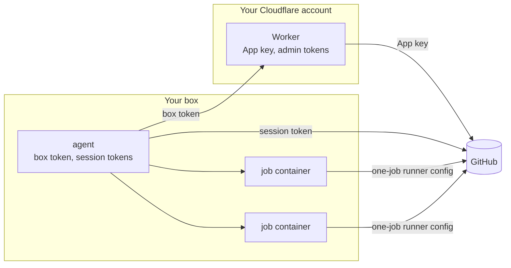

# Architecture

boxrunner runs GitHub Actions jobs in fresh containers on a Linux box you already own. This page is the contract the code follows: when the code and this page disagree, one of them is a bug. Numbers marked *measured* come from the probes in [decisions](decisions.md).

## Goals

- **One fresh container per job.** Nothing a job installs or leaves behind reaches the next job.
- **The GitHub App key never touches the box.** The box holds tokens that can do much less than the App.
- **Your main job keeps its speed.** A lighter class can use only the cores the main job leaves idle.
- **Costs nothing beyond the box today.** The Worker fits Cloudflare's free plan, and GitHub charges nothing for self-hosted minutes. GitHub announced such a fee for 2026 and then postponed it.
- **Runs unattended.** Every step converges, so a restart, a crash or a second `install` leaves the box in the same state.

## Not in scope

- **Public repositories.** Anyone who can open a pull request can run code on a self-hosted runner, so the Worker refuses public repositories. There is no switch.
- **Docker inside jobs in v0.1.** `services:`, `container:` jobs, Docker container actions and `docker build` need a Docker daemon. Jobs get none, and a `docker` command in the job prints why. Sysbox, which gives each job its own daemon without privileges, is planned.
- **Virtual-machine isolation.** Jobs share the host kernel. Firecracker and Kata need `/dev/kvm`, which common VPS plans do not offer.
- **Several boxes per Worker in v0.1.** One Worker serves one box.
- **A hosted service.** Everyone runs their own Worker and their own box.

## Parts and what each one holds



| Part | Holds | Can do |
|---|---|---|
| Worker | The App's private key and webhook secret. Admin tokens, each for one repository and ten minutes (*measured*). | What the App may do on the repositories it is installed on |
| Agent | A box token. One session token per scale set, valid 70 minutes (*measured*). | Through the Worker: find scale sets, open and close sessions, mint one-job runner configs, remove runners, all only for private repositories the App is installed on and only for the Worker's classes. Directly at GitHub: read its own queue, acknowledge messages, acquire jobs. |
| Job container | One runner config, then the job's own `GITHUB_TOKEN` and secrets | Run one job |

A session token is refused ("Invalid Claims") when it asks to mint a runner config, read, list or delete a scale set, or open a session (*measured*). Only the Worker's admin token can do those.

## How a job runs

1. The agent asks the Worker for its repositories: private repositories the App is installed on. It asks again every five minutes and stops serving any repository that left the list.
2. For each repository and class, the Worker finds or creates a runner scale set. The scale set's name and label are the class name (`boxrunner`, `boxrunner-light`), which the Worker takes from its own list. The same name in several repositories works (*measured*).
3. The agent opens a session for each scale set through the Worker and long-polls GitHub's queue with the session token. A long poll never touches the Worker.
4. Each message from the queue may offer jobs (`JobAvailable`). The agent acquires every offered job and acknowledges the message. Each message also carries the scale set's statistics.
5. The scheduler compares assigned jobs with runners and decides which runners to start.
6. To start a runner, the agent asks the Worker for a one-job runner config and starts a container with it in the environment. The runner takes one job and exits, and the agent removes the container.

A job queued while the box is down waits for it. When the box opens its session, the job is already assigned to the scale set (*measured*).

## Agent internals

```text
Config
  classes: [Class]
Class
  name      the label in runs-on; must be one of the Worker's classes
  cpus, memory, pids, shm
  priority  normal | idle
  max       runners of this class at once on this box
  image
Runner      requested -> starting -> running -> exited
            failed to start after 3 minutes -> removed
```

**One owner for runner state.** Each scale set has a listener goroutine. It acquires jobs, sends the scale set's latest statistics to the scheduler and acknowledges. It never starts containers, so a slow `docker run` never holds the queue. One scheduler goroutine owns every runner and decides with a pure function: observed state in, actions out. Its tests use literal states and literal expected actions.

Scheduler rules:

- A class never has more than `max` runners starting or running.
- A scale set needs as many runners as it has assigned jobs. Missing runners start in order of the oldest waiting job, while the class has room.
- A runner that has not taken a job within three minutes is removed through the Worker, and its container stops. A minted runner that never started can be removed (*measured*).

**Startup and shutdown converge.** The agent keeps no state file. Docker's container labels and GitHub's scale sets are the state.

- **On stop**, the agent closes its sessions and removes the runners that have not taken a job. Jobs that are running keep running.
- **On start**, it adopts the containers labelled with its box name. Running jobs count toward `max`, and containers whose runner never took a job are removed. Then it opens its sessions.
- **After a crash**, a session left open blocks a new one with 409. GitHub released one such session after about a minute (*measured* once). The agent retries with backoff until then.
- **It never deletes and re-creates a scale set** to get around the block. A job already assigned to a deleted scale set stays queued, and a new scale set with the same name does not take it (*measured*).

**Every call to the Worker backs off** exponentially with jitter, up to five minutes, and the systemd unit limits restarts. A loop on the box must never spend the Worker's daily request allowance.

## Priority classes

A class with `priority = idle` runs in `boxrunner_idle.slice`, a top-level systemd slice with `CPUWeight=idle`. The kernel schedules its processes as SCHED_IDLE: they use any core nothing else wants and step aside at once otherwise. Normal classes run in Docker's default cgroup.

The slice must be top level. systemd reads a dash in a slice name as nesting, so `boxrunner-idle.slice` would sit inside `boxrunner.slice` and only be idle against its siblings. `boxrunner doctor` checks that `cpu.idle` reads 1 for the slice the containers actually run in.

Measured on a 4-core ARM box, CPU only: four timed threads of a normal job took 1,319 ms alone, 1,345 ms beside four busy threads in the idle slice, and 6,536 ms beside four busy threads at normal priority. Memory and disk I/O are not prioritised; give each class a memory limit that fits beside the others.

## Job containers

- **Limits from the class.** `--cpus`, `--memory` with equal `--memory-swap`, `--pids-limit` and `--shm-size`. No host mounts and no Docker socket.
- **Own network.** Jobs run on the bridge `boxrunner0` with traffic between containers turned off.
- **Firewall rules.** From that bridge, the host accepts nothing (INPUT), and forwarded traffic to these addresses is dropped:
  - private ranges
  - `100.64.0.0/10`, where Tailscale lives
  - `169.254.0.0/16`, the cloud metadata service
  - the IPv6 equivalents

  DNS keeps working through Docker's resolver. The agent re-applies the rules on every start, and `doctor` starts a container that tries the host, a private address and the metadata address and fails if any answers.
- **Disk floor.** The agent starts no runner while `/var/lib/docker` has less free space than the floor (default 10 GB). It stops the largest job container if free space falls below half the floor.

## Image

`install` builds the job image on the box from GitHub's official `ghcr.io/actions/actions-runner` image, plus `zstd`, `build-essential`, Python and `RUNNER_TOOL_CACHE=/opt/hostedtoolcache`. The agent checks the runner's latest release daily through the release page's redirect, which needs no API quota. It rebuilds the image only when the version changed, and never while a job of a normal-priority class runs. Runners keep self-update on as a safety net. A class can name any image built `FROM boxrunner/runner`.

## Worker

The Worker runs on Cloudflare's free plan. Its state lives in one SQLite-backed Durable Object:

- the App's id, private key and webhook secret
- the hash of the box token
- the class list
- cached tokens: the App JWT for nine minutes, admin tokens for nine minutes, single-flight so concurrent calls derive them once

### Setup

Setup happens in the browser, and nobody copies a private key.

1. **Deploy.** Deploy the Worker with `boxrunner worker deploy`, which uses Wrangler. A Deploy to Cloudflare button is planned for when the repository is public. Deploying sets `SETUP_SECRET`.
2. **Create the App.** Open `/setup` and enter the setup secret, which the form posts rather than putting it in a URL. The page sends GitHub an App manifest with a `state` value that the Worker signs and ties to a cookie. GitHub creates the App under your account and redirects back. The Worker checks `state`, converts the code and keeps the key. The key never reaches your browser, your box or boxrunner's site.
3. **Install the App** on the repositories that should use the box.
4. **Install the agent.** The page shows a box token once, with the command that installs the agent.

After that, `/setup` answers 410 until the owner resets it with Wrangler.

### API for the agent

Every endpoint is authenticated with the box token and versioned under `/v1`.

| Endpoint | Does |
|---|---|
| `GET /v1/repos` | Private repositories the App is installed on |
| `POST /v1/scalesets` | Find or create the scale set for a repository and one of the Worker's classes |
| `POST /v1/sessions` | Open a session; returns the queue URL and session token |
| `PATCH /v1/sessions/:id` | Refresh a session |
| `DELETE /v1/sessions/:id` | Close a session |
| `POST /v1/runners` | Mint a one-job runner config for a scale set |
| `DELETE /v1/runners/:id` | Remove a runner that has not taken a job |

The Worker checks on every call that the scale set or runner belongs to a repository it serves. Before it opens a session or mints a runner, it reads the repository's visibility. A repository made public gets the answer 410 and has its scale set deleted, which disconnects its runners. Because runners start when a job is waiting, the check runs seconds before the job, not hours.

## Agent commands

One static Go binary for `linux/amd64` and `linux/arm64`, run by one systemd unit.

| Command | Does |
|---|---|
| `boxrunner install` | Converges the box: Docker, the slice, the network and firewall, the unit, the config, the image. Re-running is the upgrade path. |
| `boxrunner status` | Classes, runners and their jobs, recent jobs with queue wait and duration |
| `boxrunner doctor` | Checks Docker, cgroup v2, the idle slice, the firewall from inside a container, free disk, clock skew, the Worker and the token |
| `boxrunner uninstall` | Closes sessions and removes the unit, containers, network, rules, slice and files |
| `boxrunner worker deploy` | Deploys the Worker with Wrangler and opens its setup page |

## Decisions

The decisions behind this page, with their evidence, are in [decisions.md](decisions.md).
